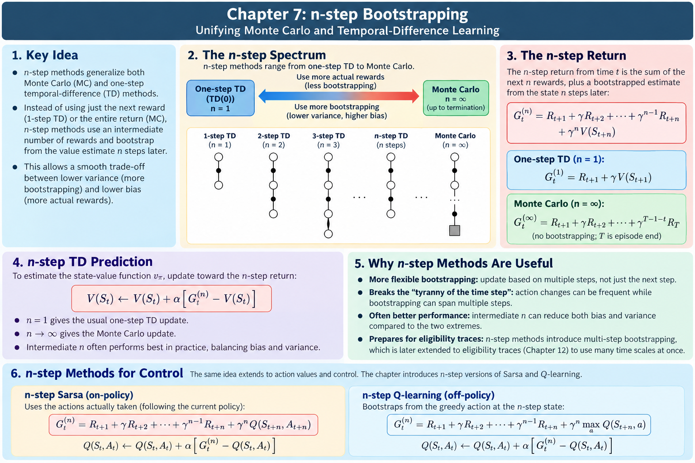

import DemoFrame from '../../../../components/DemoFrame.astro';

:::note[Not written yet]
This chapter is planned but not yet drafted. The outline below is the intended
scope; chapters are written in reading order.
:::

## Learning objective

One knob spans Monte Carlo at one end and TD(0) at the other. Eligibility traces make that knob cheap.

## Planned scope

- n-step returns and n-step TD
- The $\lambda$-return
- TD($\lambda$) with accumulating traces
- Forward view vs. backward view
- Choosing $n$ and $\lambda$ in practice

## Summary of key knowledge

### n-step TD learning

The key idea of n-step TD is to learn from multiple future rewards before using an estimated value to predict what happens afterward.
It bridges the gap between one-step Temporal-Difference (TD) learning and Monte Carlo (MC) learning.

**How n-step TD works**

- 1-step TD: Uses one observed reward and bootstraps from the next state's estimated value.
- n-step TD: Uses the next $n$ observed rewards and bootstraps from the state $n$ steps ahead.
- Monte Carlo: Uses all observed rewards until the episode terminates, without bootstrapping.

| Concept | Difficulty | Why it's difficult |
|---|---|---|
| 1. Bootstrapping | 🟢 Foundational | Understanding why an estimate can be used to improve another estimate |
| 2. Choosing the number of steps $n$ | 🟡 Moderate | More information doesn't necessarily mean better learning |
| 3. Delayed learning updates | 🟡 Moderate | The experience used for an update occurs at a different time from the update itself |
| 4. Prediction vs. control | 🟡 Moderate | Learning how valuable a state is differs from learning which action to take |
| 5. On-policy vs. off-policy learning | 🔴 Challenging | Learning about one policy while collecting data using another |
| 6. Importance sampling | 🔴 Challenging | Correcting for policy differences can introduce enormous variance |
| 7. Control variates | 🔴 Challenging | Adding a correction that changes variance without changing expected returns |
| 8. Tree backup | 🔴 Challenging | Combining actual experience with expectations over actions that weren't taken |
| 9. $Q(\sigma)$ | 🔴 Most challenging | Understanding how sampled actions and expected action values can be combined at each step |

## Interactive demo: from TD(0) to TD(1)

Two n-step TD learners, **stream A** and **stream B**, estimate state values on
the 19-state random walk. Pick a different $n$ for each stream: $n=1$ is TD(0)
and $n=\infty$ is constant-$\alpha$ Monte Carlo, the TD(1) end of the spectrum.
Both streams learn from exactly the same seeded episodes, so any gap between
their curves comes from $n$ and $\alpha$, not from luck.

<DemoFrame
  chapter="n-step-and-eligibility-traces"
  demo="td0-to-td1"
  title="From TD(0) to TD(1): compare two n-step TD streams on the random walk"
  source="src/demos/n-step/core.ts"
  height="760px"
/>

## What to observe

- Keep $\alpha=0.4$ and compare $n=1$ against $n=4$. Stream B ($n=4$) drops
  much faster at first, because each reward reaches four states back in one
  update. After about 15 episodes the curves cross and TD(0) ends lower: with a
  constant step size, the noisier 4-step targets leave a higher error floor.
  Lower stream B's $\alpha$ to about $0.2$ and the floor drops.
- Compare $n=4$ against $n=\infty$. Monte Carlo reaches every state at once but
  each target is a full noisy return, so its error stays high at large $\alpha$.
- Set runs to 1. The curves become jagged; large $n$ jumps around more because
  its targets have higher variance.
- In the sweep chart, intermediate $n$ (around 4 to 8) gives the lowest error
  over the first 10 episodes. The best $\alpha$ shrinks as $n$ grows.
- In the values chart, a large $\alpha$ makes the estimates bend past the true
  line near the ends: each update leans heavily on the latest episodes. Drop
  both streams to $\alpha=0.05$ and run 200 episodes to watch them settle onto it.
